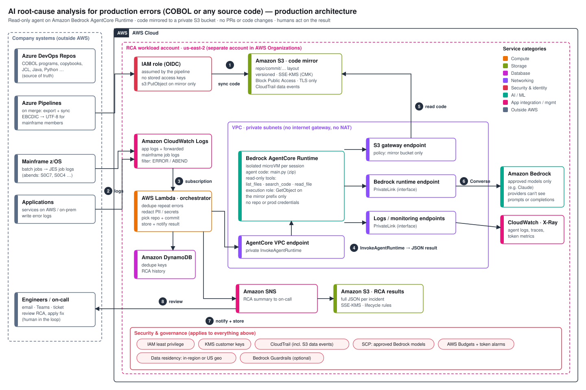

# Production architecture: RCA for COBOL or any source code

When a production job or application fails, the agent reads the error log and the code and returns
four things:
- the **root cause**
- a **2–3 sentence fix suggestion**
- the **file:line**
- a **confidence level**

It never changes code; a human acts on the result. The same design works for COBOL (programs,
copybooks, JCL) and for Java or Python.

Legend:
- **[web]**: checked against AWS documentation (see Sources).
- **[inferred]**: design judgement.
- **[unverified]**: confirm before relying on it.

## Flow (numbers match the diagram)

1. **Sync code.** On every merge, an Azure Pipelines job exports the repo to the S3 code mirror
   under `repo/commit/…`. It signs in through an IAM role with OIDC federation, so no access keys
   are stored. Mainframe members are converted from EBCDIC to UTF-8, one file per member. The
   role can only write to the mirror. **[inferred]**
2. **Error logs.** Application logs and forwarded mainframe job logs (JES messages, abend codes,
   CEEDUMP) arrive in CloudWatch Logs. **[inferred]**
3. **Subscription filter.** Matching `ERROR` / `ABEND` lines trigger the orchestrator Lambda. It
   does four things:
   - drops repeats, using DynamoDB
   - redacts PII and secrets
   - trims the log to the relevant lines (the agent caps input at 8,000 characters)
   - picks which repo and commit to analyze **[inferred]**
4. **InvokeAgentRuntime.** The orchestrator sends only the error text. The call stays private
   through the AgentCore VPC endpoint. **[web]**
   - Each request runs in its own isolated microVM session.
   - The agent returns JSON to the orchestrator.
5. **Read code.** The agent's three read-only tools (`list_files`, `search_code`, `read_file`)
   read the mirror through the S3 gateway endpoint.
   - The execution role allows `s3:GetObject` and `s3:ListBucket` on the mirror prefix only.
   - Paths outside the prefix are refused, and files are truncated at 200 KB.
   - The alternative is to mount the mirror read-only as a folder with an S3 Files or EFS access
     point, which needs VPC mode. **[web]**
6. **Converse.** The agent calls an approved Bedrock model through the Bedrock runtime
   PrivateLink endpoint. AWS states that model providers have no access to customer prompts or
   completions. **[web]**
7. **Notify and store.** The orchestrator saves the full JSON to the RCA results bucket and
   DynamoDB, and sends a short summary through SNS. **[inferred]**
8. **Review.** On-call engineers read the RCA and decide on the fix. No PR is opened
   automatically. **[inferred]**

## Why the code isn't inside the agent package

- **Code changes would mean redeploys.** Every code change would require a new agent deployment.
- **Copies pile up.** For zip deployments, AgentCore keeps code artifacts in a service-owned S3
  bucket, so each version would leave another copy of company source there. **[web]**
- **Size limits.** Zip packages are limited to 250 MB zipped and 750 MB unzipped. **[web]**
- **Separation of duties.** The people who deploy the agent shouldn't automatically hold all
  source code. **[inferred]**

## Security controls

| Area | Control |
|---|---|
| Identity | Least-privilege roles per component. The agent role is read-only on one prefix and can call only approved models. The pipeline role can write only to the mirror. |
| Network | Runtime in VPC mode in private subnets with no NAT. **[web]** Gateway endpoint for S3; interface endpoints for Bedrock, Logs and AgentCore. **[web]** |
| Encryption | SSE-KMS with customer-managed keys on the mirror and results buckets. TLS-only bucket policies. |
| Audit | CloudTrail, including S3 data events on the mirror. AgentCore and Lambda logs and traces in CloudWatch. |
| Model governance | An SCP or IAM policy allows only approved Bedrock model ARNs. Cross-region inference routes requests within the profile's geography, so use an in-region model if residency rules require it. **[web]** |
| Prompt injection | Log text is untrusted. The agent has no write tools, no network access beyond its endpoints, and no repo or production credentials. |
| Cost | AWS Budgets, a CloudWatch alarm on Bedrock token metrics, `MAX_TURNS` and input caps in the agent. |
| Accounts | A dedicated workload account in AWS Organizations, with dev and prod separated. **[inferred]** |

## Pilot → production

| | Pilot (`quick-test/`) | Production |
|---|---|---|
| Code | `sample_app/` or `s3://…/cobol-sample/` (`S3_CODE_SOURCE.md`) | S3 mirror synced by a pipeline |
| Trigger | Console **Test agent** / demo page | CloudWatch subscription → orchestrator |
| Network | Public mode | VPC mode with endpoints, no NAT |
| Output | JSON in the console | SNS + results bucket + DynamoDB |

## Sources

- [Bedrock data protection](https://docs.aws.amazon.com/bedrock/latest/userguide/data-protection.html)
- [AgentCore VPC and PrivateLink](https://docs.aws.amazon.com/bedrock-agentcore/latest/devguide/agentcore-vpc.html)
- [AgentCore file system mounts (S3 Files / EFS)](https://docs.aws.amazon.com/bedrock-agentcore/latest/devguide/runtime-filesystem-configurations.html)
- [AgentCore direct code deployment](https://docs.aws.amazon.com/bedrock-agentcore/latest/devguide/runtime-get-started-code-deploy-python.html)
- [Cross-region inference profiles](https://docs.aws.amazon.com/bedrock/latest/userguide/inference-profiles-support.html)

The diagram is generated by `docs/make_diagram.py`. Run
`python3 docs/make_diagram.py docs/architecture-production.svg` after editing it.
